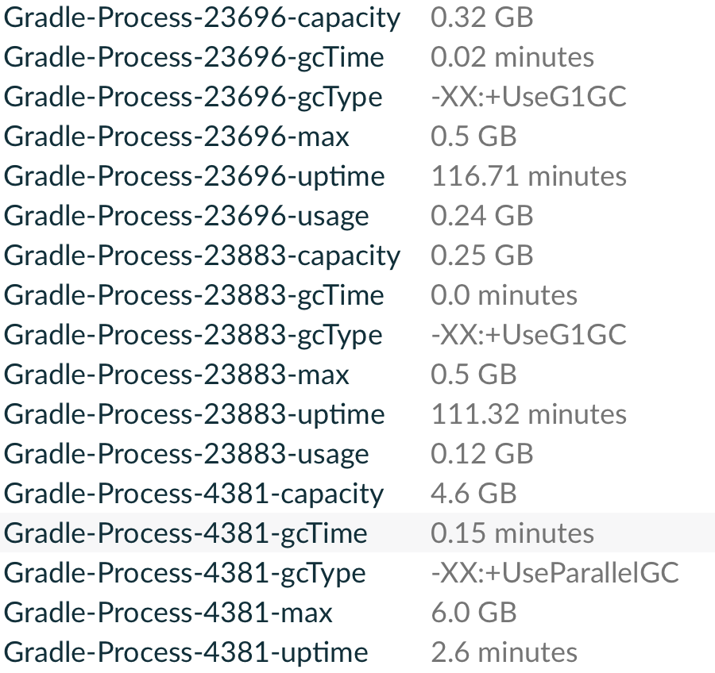

# Info Gradle Process Plugin
Includes information about Gradle processes in the Build Scans or in the build output.
The plugin is compatible with configuration cache.

> [!NOTE]
> Since version 0.3.1 `io.github.cdsap.gradleprocess` can be applied in either
> `settings.gradle(.kts)` or a build script. Applying it in settings is recommended so
> process observation is configured once for the whole build (including multi-project builds).
> Existing build-script usage keeps working without changes.

## Usage
### Settings (recommended)
Apply the plugin in the main `settings.gradle(.kts)` configuration file:

#### Kotlin
``` kotlin
plugins {
  id("io.github.cdsap.gradleprocess") version "0.3.1"
}
```

#### Groovy
``` groovy
plugins {
  id "io.github.cdsap.gradleprocess" version "0.3.1"
}
```

### Build script
The same plugin id can be applied in the root `build.gradle(.kts)`:

#### Kotlin
``` kotlin
plugins {
  id("io.github.cdsap.gradleprocess") version "0.3.1"
}
```

#### Groovy
``` groovy
plugins {
  id "io.github.cdsap.gradleprocess" version "0.3.1"
}
```

Applying the plugin from both settings and a build script is safe: processes are reported once per build.

## Output
### Build Scans
If you are using Develocity, the information about the Gradle processes will be included as custom value in the
Build Scan:



The field `Usage` represents the value obtained at the end of the build using `jstat` on the JVM process.

#### GBOS observations

GBOS output is disabled by default. Add the following to the root project's
`gradle.properties` file, or pass it on the command line as
`-PinfoGradleProcess.gbos.enabled=true`, to enable both local GBOS file sinks:

```properties
infoGradleProcess.gbos.enabled=true
```

When enabled, the plugin writes both `build/info-gradle-process/gbos.json` and
`build/info-gradle-process/gbos.ndjson`. JSON is a GBOS report envelope and NDJSON
contains one observation per line. Files are replaced after a successful build and
are not appended or timestamped.

If Develocity is applied, enable the GBOS Build Scan projection independently
with the following property in `gradle.properties` (or with the equivalent
`-P` command-line option):

```properties
infoGradleProcess.gbos.develocity.enabled=true
```

The existing `infoGradleProcess.gbos.enabled=true` property remains compatible and
enables both file sinks and the Develocity projection unless the newer
`infoGradleProcess.gbos.develocity.enabled` property is set explicitly.

| Property | Files | Custom values (Develocity present) |
| --- | --- | --- |
| neither property (default) | none | `Gradle-Process-*` only |
| `infoGradleProcess.gbos.enabled=true` | JSON and NDJSON | GBOS only |
| `infoGradleProcess.gbos.develocity.enabled=true` | none | GBOS only |
| `infoGradleProcess.gbos.enabled=true` and `infoGradleProcess.gbos.develocity.enabled=false` | JSON and NDJSON | `Gradle-Process-*` only |

Without Develocity, `infoGradleProcess.gbos.enabled` controls the file sinks; the
Develocity property has no effect because no Build Scan custom values are registered.

> [!NOTE]
Develocity 2024.2 provides new resource usage endpoints with detailed information about the different build and child processes during the execution:
https://docs.gradle.com/develocity/api-manual/ref/2024.2.html#tag/Builds/operation/GetGradleResourceUsage

### Build Output
If you are not using Develocity, the information about the Gradle processes will be included at the end of the build:
```
> Task :core:ui:compileProdDebugKotlin
┌─────────────────────────────────────────────────────────────────────────────┐
│  Gradle processes                                                           │
├─────────┬──────────┬───────────┬────────────┬───────────────┬───────────────┤
│  PID    │  Max     │  Usage    │  Capacity  │  GC Time      │  Uptime       │
├─────────┼──────────┼───────────┼────────────┼───────────────┼───────────────┤
│  10865  │  1.0 Gb  │  0.66 Gb  │  1.0 Gb    │  0.0 minutes  │  0.0 minutes  │
├─────────┼──────────┼───────────┼────────────┼───────────────┼───────────────┤
│  9011   │  0.5 Gb  │  0.2 Gb   │  0.5 Gb    │  0.0 minutes  │  0.0 minutes  │
└─────────┴──────────┴───────────┴────────────┴───────────────┴───────────────┘
BUILD SUCCESSFUL in 35s

```

## Requirements
* Gradle 7.5+

## Libraries
* `com.gradle:develocity-gradle-plugin`
* `io.github.cdsap:build-observability-core`
* `com.jakewharton.picnic:picnic`
