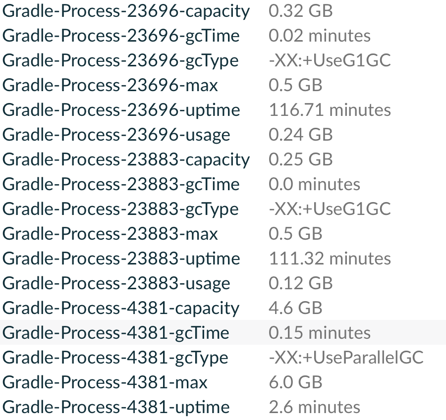

# Info Gradle Process Plugin
Includes information about Gradle processes in the Build Scans or in the build output.
The plugin is compatible with configuration cache.

> [!NOTE]
> Since version 0.3.1 `io.github.cdsap.gradleprocess` can be applied in either
> `settings.gradle(.kts)` or a build script. Applying it in settings is recommended so
> process observation is configured once for the whole build (including multi-project builds).
> Existing build-script usage keeps working without changes.

## Usage
### Settings (recommended)
Apply the plugin in the main `settings.gradle(.kts)` configuration file:

#### Kotlin
``` kotlin
plugins {
  id("io.github.cdsap.gradleprocess") version "0.3.1"
}
```

#### Groovy
``` groovy
plugins {
  id "io.github.cdsap.gradleprocess" version "0.3.1"
}
```

### Build script
The same plugin id can be applied in the root `build.gradle(.kts)`:

#### Kotlin
``` kotlin
plugins {
  id("io.github.cdsap.gradleprocess") version "0.3.1"
}
```

#### Groovy
``` groovy
plugins {
  id "io.github.cdsap.gradleprocess" version "0.3.1"
}
```

Applying the plugin from both settings and a build script is safe: processes are reported once per build.

## Output
### Build Scans
If you are using Develocity, the information about the Gradle processes will be included as custom value in the
Build Scan:



The field `Usage` represents the value obtained at the end of the build using `jstat` on the JVM process.

#### GBOS observations

GBOS file output is disabled by default. Enable either stable sink with a Gradle property:

```properties
infoGradleProcess.gbos.json.enabled=true
infoGradleProcess.gbos.ndjson.enabled=true
```

The files are written to `build/info-gradle-process/gbos.json` and
`build/info-gradle-process/gbos.ndjson`. JSON is a GBOS report envelope and NDJSON
contains one observation per line. Files are replaced after a successful build and
are not appended or timestamped. File-sink properties do not enable the Develocity
projection. Configure Develocity independently:

```properties
infoGradleProcess.gbos.develocity.enabled=true
```

When enabled with Develocity, the custom-value set is GBOS values plus the legacy
`Gradle-Process-*` values by default. Set
`infoGradleProcess.gbos.legacy.enabled=false` to publish only the GBOS values.
The legacy switch is independent of the JSON and NDJSON file sinks.

`infoGradleProcess.gbos.schema.enabled` is accepted as a compatibility alias for
the JSON file sink. Neither file-sink property selects the Develocity projection.

With Develocity present, the resulting matrix is:

| JSON/NDJSON file sinks | GBOS Develocity | Legacy output | Custom values |
| --- | --- | --- | --- |
| none, JSON, NDJSON, or both | off | on | `Gradle-Process-*` |
| none, JSON, NDJSON, or both | off | off | none |
| none, JSON, NDJSON, or both | on | on | GBOS and `Gradle-Process-*` |
| none, JSON, NDJSON, or both | on | off | GBOS only |

JSON and NDJSON file sinks are independent of this table. Without Develocity,
they only control the corresponding files; no Build Scan custom values are
registered.

> [!NOTE]
Develocity 2024.2 provides new resource usage endpoints with detailed information about the different build and child processes during the execution:
https://docs.gradle.com/develocity/api-manual/ref/2024.2.html#tag/Builds/operation/GetGradleResourceUsage

### Build Output
If you are not using Develocity, the information about the Gradle processes will be included at the end of the build:
```
> Task :core:ui:compileProdDebugKotlin
┌─────────────────────────────────────────────────────────────────────────────┐
│  Gradle processes                                                           │
├─────────┬──────────┬───────────┬────────────┬───────────────┬───────────────┤
│  PID    │  Max     │  Usage    │  Capacity  │  GC Time      │  Uptime       │
├─────────┼──────────┼───────────┼────────────┼───────────────┼───────────────┤
│  10865  │  1.0 Gb  │  0.66 Gb  │  1.0 Gb    │  0.0 minutes  │  0.0 minutes  │
├─────────┼──────────┼───────────┼────────────┼───────────────┼───────────────┤
│  9011   │  0.5 Gb  │  0.2 Gb   │  0.5 Gb    │  0.0 minutes  │  0.0 minutes  │
└─────────┴──────────┴───────────┴────────────┴───────────────┴───────────────┘
BUILD SUCCESSFUL in 35s

```

## Requirements
* Gradle 7.5+

## Libraries
* `com.gradle:develocity-gradle-plugin`
* `io.github.cdsap:build-observability-core`
* `com.jakewharton.picnic:picnic`
